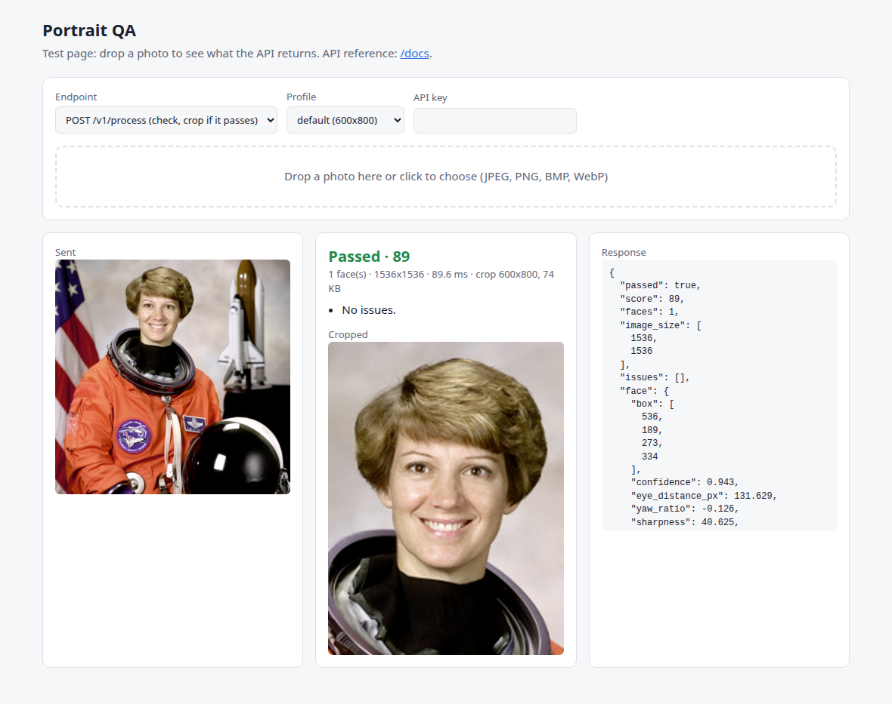

# Portrait QA

Face photo quality check and portrait crop, as a **local HTTP service**. Send a photo, get back in the same
request whether it is usable for an ID badge or a face-recognition terminal (and why not), plus a cropped,
resized portrait that fits the target device.



- **One request, one answer.** `POST /v1/process` with the photo returns the verdict, the issues found and the
  cropped JPEG. Any language that can make an HTTP call can use it: C#, Java, PHP, JavaScript, PowerShell.
- **Simple install on Windows.** One window chooses the access mode (this computer or the network), checks the
  port, creates an API key, installs the Windows service and lists the endpoints to copy. A silent `install`
  command does the same for scripted deployments. Linux: Docker image or `portrait-qa serve`.
- **Runs on premises.** Photos are biometric personal data. They are processed in memory and never stored or
  sent anywhere.
- **Stable error and issue codes** (`NO_FACE`, `BLURRY`, `TOO_DARK`…), so the client can show its own messages.

## What it checks

Detection uses [YuNet](https://github.com/opencv/opencv_zoo/tree/main/models/face_detection_yunet), a small
neural face detector bundled with OpenCV (MIT). On top of it:

| Check | Code | Severity |
|---|---|---|
| No face / more than one face | `NO_FACE`, `MULTIPLE_FACES` | error |
| Face too small (pixels between the eyes) | `FACE_TOO_SMALL` / `LOW_RESOLUTION` | error / warning |
| Head clearly turned to the side | `HEAD_TURNED` | error |
| Blurry or out of focus | `BLURRY` | error |
| Too dark / too bright | `TOO_DARK`, `TOO_BRIGHT` | error |
| Half the face in shadow | `UNEVEN_LIGHTING` | warning, error when severe |
| Low contrast, burnt highlights, face touching the edge, low detection confidence | `LOW_CONTRAST`, `OVEREXPOSED`, `FACE_CUT_OFF`, `LOW_CONFIDENCE` | warning |

Every limit is in `config.json`. A photo **passes** when it has no error and its score (0-100) reaches
`quality.min_score`. Details and known limits (head tilt is not checked): [docs/quality.md](docs/quality.md).

The crop frames the face by its eye line and face width (portrait guidance in the spirit of ICAO/ISO 19794-5),
resizes to the profile and lowers the JPEG quality until the file fits the profile's size limit. Built-in
profiles: `default` 600×800 ≤ 200 KB, `compact` 480×640 ≤ 100 KB, `badge` 300×400 ≤ 60 KB, `square`
640×640 ≤ 150 KB. Add your own for a specific terminal in `config.json`.

## Quick start

**Windows:** unzip the release, run `PortraitQA.exe` (it asks for administrator rights), choose the access
mode and port, click **Install and start**. The window shows the endpoints and opens a test page.

**Linux / Docker:**

```bash
docker build -t portrait-qa .
docker run -p 8080:8080 -v ./config.json:/config/config.json:ro portrait-qa
```

**Call it:**

```bash
curl -F image=@photo.jpg "http://localhost:8080/v1/process?profile=badge"
```

```json
{
  "passed": true,
  "score": 89,
  "faces": 1,
  "image_size": [1536, 1536],
  "issues": [],
  "face": { "box": [536, 189, 273, 334], "confidence": 0.943, "eye_distance_px": 131.6, "sharpness": 40.6 },
  "crop": { "profile": "badge", "width": 300, "height": 400, "bytes": 23411, "image_base64": "/9j/4AAQ..." },
  "elapsed_ms": 89.6
}
```

| Endpoint | What it does |
|---|---|
| `POST /v1/assess` | Quality report only |
| `POST /v1/process` | Quality report; crops only if the photo passes (the usual call) |
| `POST /v1/crop` | Always crops when a face exists, plus the report |
| `GET /v1/profiles` | Output profiles |
| `GET /v1/health` | Status and version (no key needed) |
| `GET /docs` | Interactive API reference (OpenAPI) |

The image goes as multipart (`image` field), as JSON `{"image_base64": "..."}` or as the raw body.
`?format=jpeg` returns only the cropped image, with the verdict in `X-Portrait-*` headers. Examples in C#,
Python, JavaScript and PowerShell: [docs/api.md](docs/api.md).

## Command line

The same engine without the service, for scripts and one-off batches:

```bash
portrait-qa assess photo.jpg                      # one JSON line per file; exit 1 if any fails
portrait-qa crop photo.jpg -o face.jpg -p badge
portrait-qa batch ./photos -o ./cropped           # CSV report + crops of the photos that pass
portrait-qa install --network --port 8080         # Windows: silent install of the service (admin)
portrait-qa status
portrait-qa uninstall
```

## Documentation

- [docs/api.md](docs/api.md): endpoints, request formats, response fields, error codes, client examples
- [docs/quality.md](docs/quality.md): each check, its threshold, how the score is computed, known limits
- [docs/deployment.md](docs/deployment.md): Windows window and silent install, network access and API key,
  firewall, logs, Linux/Docker, `config.json` reference
- [docs/architecture.md](docs/architecture.md): modules, request flow, design decisions
- [docs/building.md](docs/building.md): tests and the Windows build

## Development

```bash
python -m venv .venv && .venv/bin/pip install -e ".[dev]"
.venv/bin/pytest
.venv/bin/ruff check . && .venv/bin/ruff format --check .
.venv/bin/portrait-qa serve --no-log-file
```

## Origin

This started as a script that cropped cardholder photos inside one access control system, with a Haar cascade.
It was rewritten as a standalone service: a modern detector, a quality report that says *why* a photo fails,
output profiles, an HTTP API and an installer, with no dependency on any particular system.

## License

MIT. The bundled YuNet model is MIT-licensed (`portrait_qa/models/LICENSE-yunet`). Test photos come from the
scikit-image data set: the astronaut portrait is a NASA public-domain image, the cat photo is CC0.
