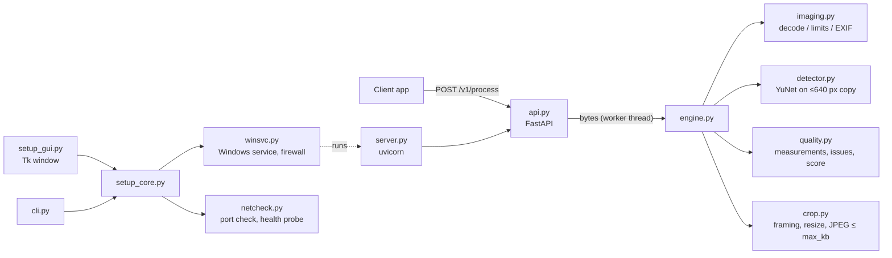

# Architecture

## Modules

| Module | Role |
|---|---|
| `imaging` | Format sniffing, decode with size/pixel limits (EXIF orientation applied by OpenCV), JPEG encode that lowers quality until the file fits |
| `detector` | YuNet wrapper. One `FaceDetectorYN` per thread (the OpenCV object is not thread-safe); detection on a downscaled copy, coordinates mapped back |
| `quality` | Measurements of the main face, issues with stable codes, score, pass/fail |
| `crop` | Output profiles; crop rectangle from the eye line and face width; tighter crop or background padding when there is no room |
| `engine` | Decode once, detect once, then assess / crop / process. A semaphore bounds concurrent work (`503 BUSY` after a timeout) |
| `api` | HTTP layer: three body formats, API key, CORS, errors as `{"error": {code, message}}`, request log |
| `config` | `config.json` into dataclasses; unknown keys and wrong types refused |
| `server` | uvicorn with our own logging (rotating file + console) |
| `cli` | `serve`, `assess`, `crop`, `batch`, `install`, `uninstall`, `status`, `gui`, and the hidden `service` entry point |
| `setup_core` | What the setup window does, without Tk: validate, check port, save, install, restart, wait for health, firewall |
| `setup_gui` | Tk window; long operations on a worker thread, results polled by the Tk thread |
| `winsvc` | pywin32: service host (`portrait-qa.exe service`), install/update, start/stop/remove, `netsh` firewall rule |
| `netcheck` | Port bind test (`SO_EXCLUSIVEADDRUSE` on Windows), next free port, `/v1/health` probe, local addresses |
| `i18n` | Window texts, pt-BR and en, picked from the Windows UI language |

## Decisions

- **Python service, not a library per language.** One HTTP contract serves every client language. Making
  the service easy to install (the window, the silent `install`) costs less than maintaining SDKs.
- **Async only for I/O.** Reading the body is async; the CPU work runs in the thread pool. OpenCV and numpy
  release the GIL, so threads run in parallel without multiprocessing. Measured: ~10 ms per 512 px photo,
  ~90 ms for a 1536 px one (the decode dominates).
- **Detection on a downscaled copy**: faster, and more accurate than at full resolution (see quality.md).
- **No roll check or straightening**: the landmarks underestimate tilt about fivefold; a wrong correction is
  worse than none (see quality.md).
- **Two executables, one folder**: `PortraitQA.exe` (windowed, administrator manifest) for the window;
  `portrait-qa.exe` (console) for the CLI and as the service binary, so the service never carries the UAC
  manifest.
- **`config.json` next to the executables**, absolute path in the service command line (services start in
  `System32`).
